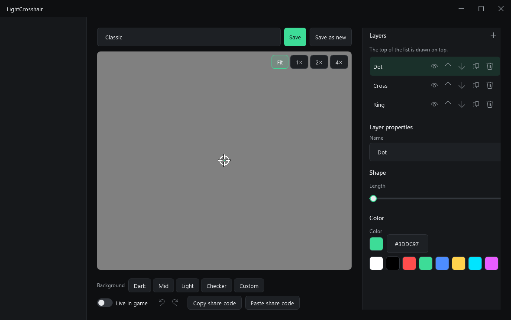
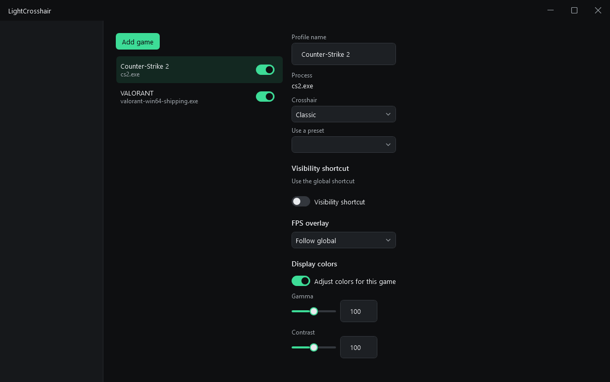

<div align="center">


<h1>LightCrosshair</h1>

<p><strong>A lightweight crosshair overlay for Windows</strong><br>
Layered crosshair editor · per-game profiles · about 15 MB of memory and no measurable CPU while you play</p>

<p>
  <a href="https://github.com/PrimeBuild-pc/LightCrosshair/releases/latest"></a>
  <a href="https://github.com/PrimeBuild-pc/LightCrosshair/releases"></a>
  <a href="https://github.com/PrimeBuild-pc/LightCrosshair/actions/workflows/build-and-test.yml"></a>
  <a href="LICENSE.md"></a>
  <a href="https://github.com/PrimeBuild-pc/LightCrosshair/stargazers"></a>
</p>

<p>
  
  
  
  
  
  
  
</p>

<p>
  <a href="https://apps.microsoft.com/detail/9MZ2872MWBJL"></a>
  <a href="https://github.com/PrimeBuild-pc/LightCrosshair/releases/latest"></a>
  <a href="https://github.com/microsoft/winget-pkgs/tree/master/manifests/p/PrimeBuild/LightCrosshair"></a>
  <a href="https://community.chocolatey.org/packages/lightcrosshair"></a>
  <a href="https://community.chocolatey.org/packages/lightcrosshair"></a>
</p>

<p>
  <a href="https://github.com/PrimeBuild-pc/LightCrosshair/releases/latest"><b>Download</b></a> ·
  <a href="#features">Features</a> ·
  <a href="#performance">Performance</a> ·
  <a href="docs/SETTINGS.md">Settings guide</a> ·
  <a href="CHANGELOG.md">Changelog</a>
</p>

</div>

---

LightCrosshair draws a custom crosshair on top of your games. You design it in a layered editor, keep your designs in a local library and assign a different crosshair to each game; the right one appears automatically when that game is in the foreground.

The overlay runs in a tiny resident process that is separate from the settings window. With settings closed it uses about 15 MB of memory, no measurable CPU and redraws nothing while the crosshair is static. Everything stays on your PC: no account, no telemetry, no game injection.

## Screenshots

| Studio | Library | Games |
|---|---|---|
| <a href="docs/images/ui-studio.png"></a> | <a href="docs/images/ui-library.png"></a> | <a href="docs/images/ui-games.png"></a> |

| Hotkeys | FPS overlay | Settings |
|---|---|---|
| <a href="docs/images/ui-hotkeys.png"></a> | <a href="docs/images/ui-fps.png"></a> | <a href="docs/images/ui-settings.png"></a> |

## Features

### Crosshair Studio

- Up to eight layers: arms, dots, rings, boxes, corner brackets and PNG images, each with position, rotation, opacity and outline. Rings and boxes can have a separate fill.
- One renderer for the overlay, the editor and the Library thumbnails, so what you see while editing is exactly what appears in game, pixel for pixel, at any window size and screen scale. Every shape is drawn symmetric around its center.
- Live in-game preview, undo/redo and layer reordering.

### Library and sharing

- 30 original presets to start from. Pick one, name your copy and use it right away.
- Favorites, search and tag filters. Next/previous hotkeys cycle through your favorites, or through all saved crosshairs when you have fewer than two favorites.
- `LC2:` share codes for vector designs and `.lcx.json` import/export with embedded images.

### Game profiles

- A crosshair, display colors, FPS overlay and shortcut overrides for each game, switched automatically when the game is in the foreground.
- Optional suggestions when a recognized game starts.

### Hide while aiming

- Hide the crosshair while you hold the aim button (usually right click), or press once to hide and again to show for games with toggle aim. Works while sprinting or crouching.
- Mouse buttons are read from raw input, the same stream games use, and every click still reaches the game. Each game can use the global setting, turn it off or use its own button.

### Display colors

- Global and per-game gamma, contrast, brightness and vibrance, previewed live while you drag and applied immediately when saved, even with the game running.
- Original values are restored on exit and recovered after a crash. AMD color support; NVIDIA Digital Vibrance and per-app driver FPS caps on supported hardware.

### FPS overlay

- FPS, frametime, 1% low and an optional smooth frametime graph, toggled from the sidebar or with Alt+F.
- Capture runs only while the overlay is enabled; the graph redraws at most 20 times per second.

### And also

- Monitor selection by model name, position offsets, startup with Windows and automatic backups.
- English, Italian, Spanish, Simplified Chinese, Russian and Japanese.

## Installation

Get it from the [Microsoft Store](https://apps.microsoft.com/detail/9MZ2872MWBJL) (includes the .NET runtime, updates automatically), download the installer or the portable ZIP from the [latest release](https://github.com/PrimeBuild-pc/LightCrosshair/releases/latest), or use a package manager:

```powershell
winget install --id PrimeBuild.LightCrosshair --exact
choco install lightcrosshair
```

LightCrosshair requires the [.NET 10 Desktop Runtime](https://dotnet.microsoft.com/en-us/download/dotnet/10.0) for your architecture (x64 or ARM64) and runs on Windows 11 or any [Windows version supported by .NET 10](https://learn.microsoft.com/en-us/dotnet/core/install/windows#supported-versions). Package-manager versions can lag behind the GitHub release while they are reviewed.

Start `LightCrosshair.exe`, then open settings from the tray icon or with Alt+L. With the portable ZIP, keep `LightCrosshair.exe` and `LightCrosshair.UI.exe` in the same folder. Closing the settings window keeps the crosshair running in the tray; **Exit LightCrosshair** in Settings stops everything and restores display colors.

Coming from 1.x? Your crosshairs, preferences, hotkeys and game associations are imported automatically on the first start, and the old files are left untouched. See the [settings and recovery guide](docs/SETTINGS.md) for details.

## Default hotkeys

| Binding | Action |
|---|---|
| Alt+X | Show or hide the crosshair |
| Alt+C | Next crosshair (favorites when at least two exist) |
| Alt+V | Previous crosshair (favorites when at least two exist) |
| Alt+L | Open or close settings |
| Alt+F | Show or hide the FPS overlay |
| *not set* | Hide while aiming: hold to hide, press to hide / show, or hold to show |

Every binding can be changed or cleared on the Hotkeys page: click the field and press a key, a mouse button or a combination, or pick a mouse button from its ▾ menu. Conflicts and registration failures are shown right there.

## Performance

LightCrosshair runs as two processes: a small resident Core that draws the overlay, and a settings app that only runs while you use it.

| Release package, Ryzen 7 5800X3D, Windows 11 | Result |
|---|---|
| Resident Core, private memory at idle | **15.4 MB** (1.9: 21.1 MB) |
| Resident Core, CPU at idle (60 × 1 s samples) | **0.00 %** of one core, below sampling resolution (1.9: 0.57 %) |
| Overlay redraws while the crosshair is static | **0** per second |
| Repeating timers with the FPS overlay off | **0** |
| Settings window closed (parked, then exits after 5 minutes) | about **5 MB** working set |
| Reopening the parked settings window | **16–29 ms** to the first frame |
| Settings window cold start | about **0.5 s** |
| Rendering a heavy four-layer crosshair | **3.5 ms** median |
| FPS overlay | runs only while enabled; the frametime graph redraws at most 20 times per second |
| Download | **6.1 MB** ZIP or installer |


Idle values are means of 60 one-second samples after a 10-second warmup, with a static crosshair, FPS off and settings closed, on the machine and Release builds shown in the chart.


The Library soak test opens and closes the real settings app 50 times, scrolls through the Library and waits for all 31 thumbnails each time, then samples the continuously running Core after the settings app exits.

The [cold and parked UI test](docs/perf/final-ui-open.csv) records one cold launch and 20 reopens during a hardware DX12 borderless probe; warm first frames range from 16.0 to 28.9 ms on this machine.

Charts and the table use decimal MB and CPU as a percentage of one logical core; a sampled zero is below measurement resolution. The shaded growth target applies after five sessions. The idle chart and the first four rows of the table come from the 2.0.0 release package; the other rows come from the final test rounds. [CSV data, build identities and methods](docs/perf/README.md) include the separate [20-session UI open/close run](docs/perf/ui-cycles.csv).

## Limitations and safety

- Use windowed or borderless mode. Exclusive fullscreen can hide desktop overlays.
- LightCrosshair does not inject into games, read game memory, capture the screen or install a kernel driver. Still, check the rules of each game and anti-cheat system: this does not guarantee that overlays are allowed.
- NVIDIA Digital Vibrance and per-app FPS caps are **not yet verified on NVIDIA hardware**.
- Display-color support depends on the driver and display mode, and colors apply to the whole display. Failures are reported in the app and logged.
- The FPS overlay reads ETW present events and is not a frame-generation detector. When no frames arrive for two seconds it shows “–” with the reason; permissions or the game's presentation path can prevent capture.
- Recording detection looks for recorder processes, so the crosshair can be hidden while a recorder is open but not recording.

## Documentation

[Settings guide](docs/SETTINGS.md) · [Changelog](CHANGELOG.md) · [Performance data](docs/perf/README.md) · [Third-party notices](docs/THIRD_PARTY_NOTICES.md)

To build from source, install the .NET 10 SDK and run `dotnet build -c Release` and `dotnet test -c Release`; `pwsh scripts/build-release.ps1` produces the x64 and ARM64 packages.

## Support

If LightCrosshair is useful to you, consider supporting the project.

<p>
  <a href="https://ko-fi.com/primebuild"></a>
  <a href="https://paypal.me/PrimeBuildOfficial?country.x=IT&locale.x=it_IT"></a>
  <a href="https://github.com/PrimeBuild-pc/LightCrosshair/issues/new"></a>
  <a href="https://github.com/PrimeBuild-pc/LightCrosshair/issues/new"></a>
</p>

## License

[MIT](LICENSE.md). See [third-party notices](docs/THIRD_PARTY_NOTICES.md) for included components.
