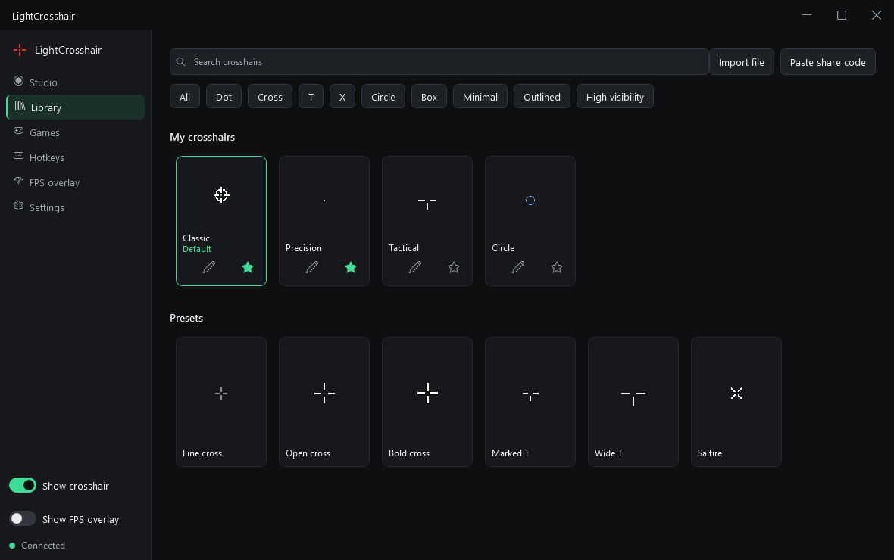
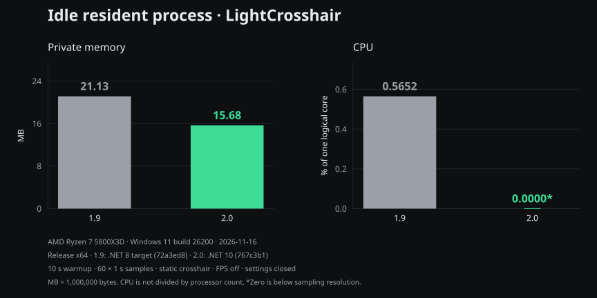

# LightCrosshair 2.0

LightCrosshair is a crosshair overlay for Windows with a layered editor, a local library and executable-based game profiles. Build and preview your design in the settings app; the separate, click-through Core keeps the overlay running when you close it. Crosshairs, profiles and sharing stay local.

## Download

Requires [.NET 10 Desktop Runtime](https://dotnet.microsoft.com/en-us/download/dotnet/10.0) for your package's architecture. Use Windows 11 or a [Windows edition supported by .NET 10](https://learn.microsoft.com/en-us/dotnet/core/install/windows#supported-versions).

Choose the 2.0 release on the [releases page](https://github.com/PrimeBuild-pc/LightCrosshair/releases):

| Package | File | SHA256 |
|---|---|---|
| Installer, x64 | `LightCrosshair-Setup-2.0.0.exe` | TBD |
| Portable ZIP, x64 | `LightCrosshair-v2.0.0-win-x64.zip` | TBD |
| Portable ZIP, ARM64 | `LightCrosshair-v2.0.0-win-arm64.zip` | TBD |

For a ZIP, extract the whole folder and keep `LightCrosshair.exe` and `LightCrosshair.UI.exe` together. Start `LightCrosshair.exe`; open settings from the tray or with Alt+L. Closing the settings window with × leaves the Core running and parks the settings process for up to five minutes for quick reopening. Use **Exit LightCrosshair** to stop both processes and restore display colors.

WinGet and Chocolatey packages may follow the GitHub release. Once the 2.0 packages are published:

```powershell
winget install --id PrimeBuild.LightCrosshair --exact --version 2.0.0
choco install lightcrosshair --version=2.0.0
```

The [Chocolatey package page](https://community.chocolatey.org/packages/lightcrosshair) and package-manager listings show which version is available.

## Screenshots

| Studio | Library | Games |
|---|---|---|
| <a href="docs/images/ui-studio.png"></a> | <a href="docs/images/ui-library.png"></a> | <a href="docs/images/ui-games.png"></a> |

| Hotkeys | FPS overlay | Settings |
|---|---|---|
| <a href="docs/images/ui-hotkeys.png"></a> | <a href="docs/images/ui-fps.png"></a> | <a href="docs/images/ui-settings.png"></a> |

## Features

- Up to eight editable layers: arms, dots, rings, boxes, corner brackets and PNG images, with position, rotation, opacity and outlines. Rings and boxes can have a separate fill.
- Shared rendering for the editor and overlay, live in-game preview, undo/redo and pixel-based geometry.
- A local gallery with 30 original presets: choose one, name the saved copy and use it immediately. Saved crosshairs support favorites, search and tag filters. Use applies to the active game; the card menu can explicitly set the all-apps default.
- Next/previous cycling uses favorites when at least two exist, otherwise all saved crosshairs, and saves the choice for the active game or as the default.
- `LC2:` share codes for vector designs and `.lcx.json` import/export with embedded images.
- Game profiles for crosshairs, display colors, visibility bindings and FPS overlay overrides. Optional suggestions for recognized games.
- Global and per-game gamma, contrast, brightness and vibrance, with live slider preview and recovery of original display values; AMD color support; NVIDIA Digital Vibrance and per-app driver FPS caps on supported hardware.
- A dedicated FPS overlay page and sidebar switch, with FPS, frametime, 1% low and an optional two-second frametime graph. Capture runs only while enabled; the graph draws at most 20 times per second.
- Separate Toggle and While held bindings: hold right mouse to hide the crosshair while aiming, then release to restore it. Games can follow the global hold, disable it or use their own. Keyboard and mouse input continues to reach the game.
- Monitor selection by model name, position offsets, startup with Windows, automatic backups and display-color recovery after a crash.
- English, Italian, Spanish, Simplified Chinese, Russian and Japanese.

## Upgrading from 1.9

Exit 1.9 before starting 2.0. On the first launch, crosshairs, supported preferences, hotkeys and executable associations are imported automatically into `%AppData%\LightCrosshair\v2`. Original v1 files are left untouched, with migration copies kept in the new backup folder. The active working copy is merged into its source profile; an old disabled crosshair becomes a globally hidden overlay with its editable layers still visible.

Frame Cap Assistant, Detailed FPS mode, the old diagnostic graphs and pacing analysis, RTSS/frame-generation heuristics, G-Sync/FreeSync status displays and per-profile direct-select hotkeys are removed. NVIDIA per-app caps remain available in Games; existing driver caps from 1.x are left unchanged until explicitly managed in 2.0. See the [settings and recovery guide](docs/SETTINGS.md).

## Performance



Idle values are means of 60 one-second samples after a 10-second warmup, with a static crosshair, FPS off and settings closed, on the machine and Release builds shown in the chart.


The historical Library soak opens and closes the real UI 50 times, scrolls through the Library and waits for all 31 thumbnails each time, then samples the continuously running Core after the UI exits.

The final [cold/parked UI test](docs/perf/final-ui-open.csv) records one cold launch and 20 reopens during a hardware DX12 borderless probe; warm first frames range from 16.0 to 28.9 ms on this machine.

Charts use decimal MB and CPU as a percentage of one logical core; a sampled zero is below measurement resolution. The shaded growth target applies after five sessions. These are recorded pre-release measurements; [CSV data, build identities and methods](docs/perf/README.md) include the separate [20-session UI open/close run](docs/perf/ui-cycles.csv).

## Default hotkeys

| Binding | Action |
|---|---|
| Alt+X | Show or hide the crosshair |
| Alt+C | Next favorite when at least two exist; otherwise next saved crosshair |
| Alt+V | Previous favorite when at least two exist; otherwise previous saved crosshair |
| Alt+L | Open or close settings |

Cycling follows Library order and saves the selection into the active configured game profile, or the default when no configured game is active. Presets enter the cycle after you save a copy. Bindings can be changed or cleared in Hotkeys, including an independent, initially unbound While held action (Hold to hide / Hold to show). Wheel bindings are toggle-only. Input continues to reach the game; conflicts and registration failures are shown in the UI.

## Limitations and safety

- Use windowed or borderless mode. Exclusive fullscreen can hide ordinary desktop overlays.
- No game injection, game-memory access, screen capture or kernel driver is used. Check the rules of each game and anti-cheat system; this does not guarantee permission or compatibility.
- NVIDIA Digital Vibrance and per-app FPS caps are **not yet verified on NVIDIA hardware**.
- Display-color support depends on the driver and display mode; a failure is reported and logged. Colors apply to the whole display. An enabled game profile overrides global colors; leaving it restores global colors or the original calibration. Errors appear inline.
- FPS telemetry uses external ETW present events and is not a frame-generation detector. After two seconds without frames, the overlay shows “–” and a localized reason; permissions or the game's presentation path can prevent capture.
- Recording detection checks for recorder processes. It can hide the crosshair while the recorder is open but not recording.

## Documentation

[Settings guide](docs/SETTINGS.md) · [Changelog](CHANGELOG.md) · [Performance data](docs/perf/README.md) · [Third-party notices](docs/THIRD_PARTY_NOTICES.md)

To build, install the .NET 10 SDK and run `dotnet build -c Release`, `dotnet test -c Release`, then `pwsh scripts/build-release.ps1` for both architectures.

## License

[MIT](LICENSE.md). See [third-party notices](docs/THIRD_PARTY_NOTICES.md) for included components.
