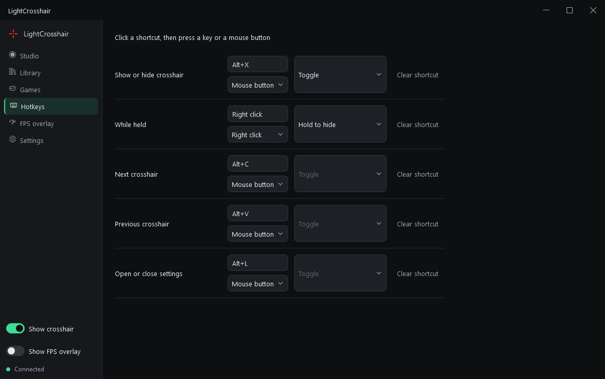
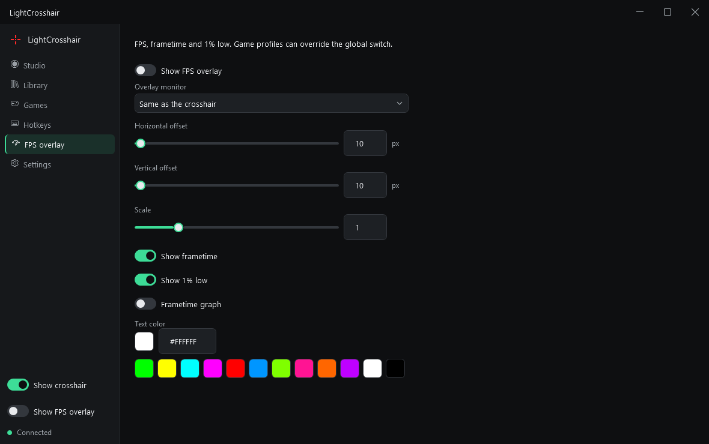
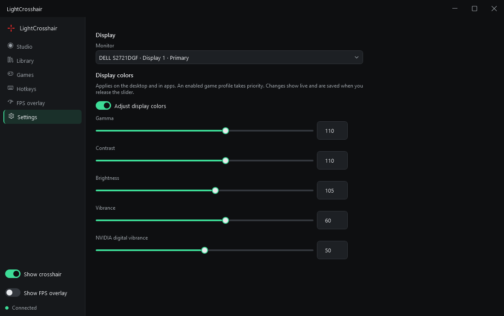

<div align="center">


<p><strong>A lightweight crosshair overlay for Windows</strong><br>
Layered crosshair editor · per-game profiles · about 15 MB of memory and no measurable CPU while you play</p>

<p>
  <a href="https://github.com/PrimeBuild-pc/LightCrosshair/releases/latest"></a>
  <a href="https://github.com/PrimeBuild-pc/LightCrosshair/releases"></a>
  <a href="https://github.com/PrimeBuild-pc/LightCrosshair/actions/workflows/build-and-test.yml"></a>
  <a href="LICENSE.md"></a>
  <a href="https://github.com/PrimeBuild-pc/LightCrosshair/stargazers"></a>
</p>

<p>
  
  
  
  
  
  
  
</p>

<p>
  <a href="https://github.com/PrimeBuild-pc/LightCrosshair/releases/latest"></a>
  <a href="https://github.com/microsoft/winget-pkgs/tree/master/manifests/p/PrimeBuild/LightCrosshair"></a>
  <a href="https://community.chocolatey.org/packages/lightcrosshair"></a>
  <a href="https://community.chocolatey.org/packages/lightcrosshair"></a>
</p>

<p>
  <a href="#download"><b>Download</b></a> ·
  <a href="#features">Features</a> ·
  <a href="#performance">Performance</a> ·
  <a href="docs/SETTINGS.md">Settings guide</a> ·
  <a href="CHANGELOG.md">Changelog</a>
</p>

</div>

---

LightCrosshair is a crosshair overlay for Windows with a layered editor, a local library and executable-based game profiles. Build and preview your design in the settings app; the separate, click-through Core keeps the overlay running when you close it. Crosshairs, profiles and sharing stay local.

It is built to stay out of the way: with settings closed, the resident process uses about 15 MB of memory, no measurable CPU and redraws nothing while the crosshair is static. See [Performance](#performance).

## Download

Requires [.NET 10 Desktop Runtime](https://dotnet.microsoft.com/en-us/download/dotnet/10.0) for your package's architecture. Use Windows 11 or a [Windows edition supported by .NET 10](https://learn.microsoft.com/en-us/dotnet/core/install/windows#supported-versions).

Choose the 2.0.1 release on the [releases page](https://github.com/PrimeBuild-pc/LightCrosshair/releases):

| Package | File | SHA256 |
|---|---|---|
| Installer, x64 | `LightCrosshair-Setup-2.0.1.exe` | `D798736DD32841C0C0E480BD2F4C4C0998C63549FA9A4BFDC8AB151A1B646CCD` |
| Portable ZIP, x64 | `LightCrosshair-v2.0.1-win-x64.zip` | `1BBA46E353CFFFD0A20EA83C7E013A149261577FBAA3BCF930F6936F8C7A4388` |
| Portable ZIP, ARM64 | `LightCrosshair-v2.0.1-win-arm64.zip` | `A5C6A239F8675948C8CB3D03BDFC0AC6F5D7B31AB4748295873DA8F77E05BAA7` |

For a ZIP, extract the whole folder and keep `LightCrosshair.exe` and `LightCrosshair.UI.exe` together. Start `LightCrosshair.exe`; open settings from the tray or with Alt+L. Closing the settings window with × leaves the Core running and parks the settings process for up to five minutes for quick reopening; Settings → Behavior → **When I close the window** can make × exit everything instead. Use **Exit LightCrosshair** to stop both processes and restore display colors.

WinGet and Chocolatey packages may follow the GitHub release. Once the 2.0.1 packages are published:

```powershell
winget install --id PrimeBuild.LightCrosshair --exact --version 2.0.1
choco install lightcrosshair --version=2.0.1
```

The [Chocolatey package page](https://community.chocolatey.org/packages/lightcrosshair) and package-manager listings show which version is available.

## Screenshots

| Studio | Library | Games |
|---|---|---|
| <a href="docs/images/ui-studio.png"></a> | <a href="docs/images/ui-library.png"></a> | <a href="docs/images/ui-games.png"></a> |

| Hotkeys | FPS overlay | Settings |
|---|---|---|
| <a href="docs/images/ui-hotkeys.png"></a> | <a href="docs/images/ui-fps.png"></a> | <a href="docs/images/ui-settings.png"></a> |

## Features

- Up to eight editable layers: arms, dots, rings, boxes, corner brackets and PNG images, with position, rotation, opacity and outlines. Rings and boxes can have a separate fill.
- One renderer for the overlay, the editor preview and the Library thumbnails: every shape is drawn symmetric around its center, and the preview and thumbnails show the in-game pixels exactly at any window size and screen scale. Smooth edges rounds arm ends and outline corners. Live in-game preview and undo/redo.
- A local gallery with 30 original presets: choose one, name the saved copy and use it immediately. Saved crosshairs support favorites, search and tag filters. Use applies to the active game; the card menu can explicitly set the all-apps default.
- Next/previous cycling uses favorites when at least two exist, otherwise all saved crosshairs, and saves the choice for the active game or as the default.
- `LC2:` share codes for vector designs and `.lcx.json` import/export with embedded images.
- Game profiles for crosshairs, display colors, visibility bindings and FPS overlay overrides. Optional suggestions for recognized games.
- Global and per-game gamma, contrast, brightness and vibrance, applied live without flicker while you drag, kept when you release and applied immediately when saved (also with the game running), with recovery of original display values; AMD color support; NVIDIA Digital Vibrance and per-app driver FPS caps on supported hardware.
- A dedicated FPS overlay page, sidebar switch and Alt+F hotkey, with FPS, frametime, 1% low and an optional two-second frametime graph in the text color or its own color. Capture runs only while enabled; the graph draws at most 20 times per second.
- Separate show/hide and Hide while aiming bindings: hold right mouse to hide the crosshair while aiming (also while sprinting or crouching with Shift/Ctrl), then release to restore it, or press once to hide and again to show for games with toggle aim. Mouse buttons are read from raw input, the same stream games use. Each game can Use global, turn it Off or use a Custom binding; these choices save immediately. Keyboard and mouse input continues to reach the game.
- Monitor selection by model name, position offsets, startup with Windows, automatic backups and display-color recovery after a crash.
- English, Italian, Spanish, Simplified Chinese, Russian and Japanese.

## Upgrading from 1.9

Exit 1.9 before starting 2.0. On the first launch, crosshairs, supported preferences, hotkeys and executable associations are imported automatically into `%AppData%\LightCrosshair\v2`. Original v1 files are left untouched, with migration copies kept in the new backup folder. The active working copy is merged into its source profile; an old disabled crosshair becomes a globally hidden overlay with its editable layers still visible.

Frame Cap Assistant, Detailed FPS mode, the old diagnostic graphs and pacing analysis, RTSS/frame-generation heuristics, G-Sync/FreeSync status displays and per-profile direct-select hotkeys are removed. NVIDIA per-app caps remain available in Games; existing driver caps from 1.x are left unchanged until explicitly managed in 2.0. See the [settings and recovery guide](docs/SETTINGS.md).

## Performance

LightCrosshair 2.0 runs as two processes: a small resident Core that draws the overlay, and a settings app that only runs while you use it.

| v2.0.0 release package, Ryzen 7 5800X3D, Windows 11 | Result |
|---|---|
| Resident Core, private memory at idle | **15.4 MB** (1.9: 21.1 MB) |
| Resident Core, CPU at idle (60 × 1 s samples) | **0.00 %** of one core, below sampling resolution (1.9: 0.57 %) |
| Overlay redraws while the crosshair is static | **0** per second |
| Repeating timers with the FPS overlay off | **0** |
| Settings window closed (parked, then exits after 5 minutes) | about **5 MB** working set |
| Reopening the parked settings window | **16–29 ms** to the first frame |
| Settings window cold start | about **0.5 s** |
| Rendering a heavy four-layer crosshair | **3.5 ms** median |
| FPS overlay | runs only while enabled; the frametime graph redraws at most 20 times per second |
| Download | **6.1 MB** ZIP or installer |


Idle values are means of 60 one-second samples after a 10-second warmup, with a static crosshair, FPS off and settings closed, on the machine and Release builds shown in the chart.


The historical Library soak opens and closes the real UI 50 times, scrolls through the Library and waits for all 31 thumbnails each time, then samples the continuously running Core after the UI exits.

The final [cold/parked UI test](docs/perf/final-ui-open.csv) records one cold launch and 20 reopens during a hardware DX12 borderless probe; warm first frames range from 16.0 to 28.9 ms on this machine.

Charts and the table use decimal MB and CPU as a percentage of one logical core; a sampled zero is below measurement resolution. The shaded growth target applies after five sessions. The idle chart and the first four rows of the table come from the v2.0.0 release package; the other rows come from the final test rounds. [CSV data, build identities and methods](docs/perf/README.md) include the separate [20-session UI open/close run](docs/perf/ui-cycles.csv).

## Default hotkeys

| Binding | Action |
|---|---|
| Alt+X | Show or hide the crosshair |
| Alt+C | Next favorite when at least two exist; otherwise next saved crosshair |
| Alt+V | Previous favorite when at least two exist; otherwise previous saved crosshair |
| Alt+L | Open or close settings |
| Alt+F | Show or hide the FPS overlay |

Cycling follows Library order and saves the selection into the active configured game profile, or the default when no configured game is active. Presets enter the cycle after you save a copy. Bindings can be changed or cleared in Hotkeys, including an independent, initially off Hide while aiming action (Hold to hide / Press to hide / show / Hold to show). Each binding is one field: click it and press a key or mouse button, or pick a mouse button from its ▾ menu. Wheel bindings are toggle-only. Input continues to reach the game; conflicts and registration failures are shown in the UI.

## Limitations and safety

- Use windowed or borderless mode. Exclusive fullscreen can hide ordinary desktop overlays.
- No game injection, game-memory access, screen capture or kernel driver is used. Check the rules of each game and anti-cheat system; this does not guarantee permission or compatibility.
- NVIDIA Digital Vibrance and per-app FPS caps are **not yet verified on NVIDIA hardware**.
- Display-color support depends on the driver and display mode; a failure is reported and logged. Colors apply to the whole display. An enabled game profile overrides global colors; leaving it restores global colors or the original calibration. Errors appear inline.
- FPS telemetry uses external ETW present events and is not a frame-generation detector. After two seconds without frames, the overlay shows “–” and a localized reason; permissions or the game's presentation path can prevent capture.
- Recording detection checks for recorder processes. It can hide the crosshair while the recorder is open but not recording.

## Documentation

[Settings guide](docs/SETTINGS.md) · [Changelog](CHANGELOG.md) · [Performance data](docs/perf/README.md) · [Third-party notices](docs/THIRD_PARTY_NOTICES.md)

To build, install the .NET 10 SDK and run `dotnet build -c Release`, `dotnet test -c Release`, then `pwsh scripts/build-release.ps1` for both architectures.

## Support

If LightCrosshair is useful to you, consider supporting the project.

[](https://ko-fi.com/primebuild) [](https://paypal.me/PrimeBuildOfficial?country.x=IT&locale.x=it_IT)
[](../../issues)
[](../../issues)

## License

[MIT](LICENSE.md). See [third-party notices](docs/THIRD_PARTY_NOTICES.md) for included components.
