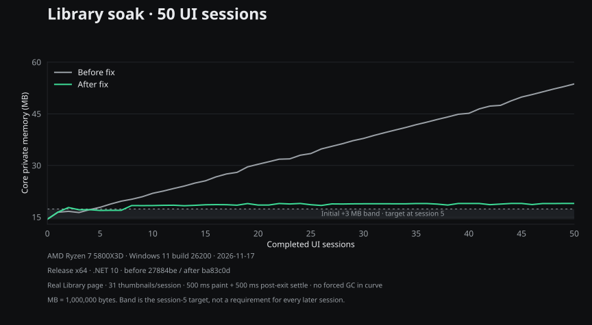

# LightCrosshair 2.0

LightCrosshair is a crosshair overlay for Windows with a layered editor, a local library and executable-based game profiles. Build and preview your design in the settings app; the separate, click-through Core keeps the overlay running when you close it. Crosshairs, profiles and sharing stay local.

## Download

Requires [.NET 10 Desktop Runtime](https://dotnet.microsoft.com/en-us/download/dotnet/10.0) for your package's architecture. Use Windows 11 or a [Windows edition supported by .NET 10](https://learn.microsoft.com/en-us/dotnet/core/install/windows#supported-versions).

Choose the 2.0 release on the [releases page](https://github.com/PrimeBuild-pc/LightCrosshair/releases):

| Package | File | SHA256 |
|---|---|---|
| Installer, x64 | `LightCrosshair-Setup-2.0.0.exe` | TBD |
| Portable ZIP, x64 | `LightCrosshair-v2.0.0-win-x64.zip` | TBD |
| Portable ZIP, ARM64 | `LightCrosshair-v2.0.0-win-arm64.zip` | TBD |

For a ZIP, extract the whole folder and keep `LightCrosshair.exe` and `LightCrosshair.UI.exe` together. Start `LightCrosshair.exe`; open settings from the tray or with Alt+L. Closing settings leaves the Core running. Use **Exit LightCrosshair** to stop both processes and restore display colors.

WinGet and Chocolatey packages may follow the GitHub release. Once the 2.0 packages are published:

```powershell
winget install --id PrimeBuild.LightCrosshair --exact --version 2.0.0
choco install lightcrosshair --version=2.0.0
```

The [Chocolatey package page](https://community.chocolatey.org/packages/lightcrosshair) and package-manager listings show which version is available.

## Screenshots

| Studio | Library | Games |
|---|---|---|
| <a href="docs/images/ui-studio.png"></a> | <a href="docs/images/ui-library.png"></a> | <a href="docs/images/ui-games.png"></a> |

| Hotkeys | Settings |
|---|---|
| <a href="docs/images/ui-hotkeys.png"></a> | <a href="docs/images/ui-settings.png"></a> |

## Features

- Up to eight editable layers: arms, dots, rings, boxes, corner brackets and PNG images, with position, rotation, opacity and outlines. Rings and boxes can have a separate fill.
- Shared rendering for the editor and overlay, live in-game preview, undo/redo and pixel-based geometry.
- A local library with 30 original presets, favorites, search and tag filters.
- `LC2:` share codes for vector designs and `.lcx.json` import/export with embedded images.
- Game profiles for crosshairs, display colors, visibility bindings and FPS overlay overrides. Optional suggestions for recognized games.
- Software gamma, contrast, brightness and vibrance; AMD color support; NVIDIA Digital Vibrance and per-app driver FPS caps on supported hardware.
- Optional FPS, frametime and 1% low overlay, captured only while enabled.
- Keyboard and mouse bindings with modifiers; Toggle, Hold to hide and Hold to show for visibility.
- Monitor selection, position offsets, startup with Windows, automatic backups and display-color recovery after a crash.
- English, Italian, Spanish, Simplified Chinese, Russian and Japanese.

## Upgrading from 1.9

Exit 1.9 before starting 2.0. On the first launch, crosshairs, supported preferences, hotkeys and executable associations are imported automatically into `%AppData%\LightCrosshair\v2`. Original v1 files are left untouched, with migration copies kept in the new backup folder. The active working copy is merged into its source profile; an old disabled crosshair becomes a globally hidden overlay with its editable layers still visible.

Frame Cap Assistant, Detailed FPS mode, diagnostic graphs and pacing analysis, RTSS/frame-generation heuristics, G-Sync/FreeSync status displays and per-profile direct-select hotkeys are removed. NVIDIA per-app caps remain available in Games; existing driver caps from 1.x are left unchanged until explicitly managed in 2.0. See the [settings and recovery guide](docs/SETTINGS.md).

## Performance


Idle values are means of 60 one-second samples after a 10-second warmup, with a static crosshair, FPS off and settings closed, on the machine and Release builds shown in the chart.



The Library soak opens and closes the real UI 50 times, scrolls through the Library and waits for all 31 thumbnails each time, then samples the continuously running Core after the UI exits.

Charts use decimal MB and CPU as a percentage of one logical core; a sampled zero is below measurement resolution. The shaded growth target applies after five sessions. These are recorded pre-release measurements; [CSV data, build identities and methods](docs/perf/README.md) include the separate [20-session UI open/close run](docs/perf/ui-cycles.csv).

## Default hotkeys

| Binding | Action |
|---|---|
| Alt+X | Show or hide the crosshair |
| Alt+C | Next favorite; all saved designs if none are favorites |
| Alt+V | Previous favorite; all saved designs if none are favorites |
| Alt+L | Open or close settings |

Bindings can be changed or cleared in Hotkeys. Input continues to reach the game; conflicts and registration failures are shown in the UI.

## Limitations and safety

- Use windowed or borderless mode. Exclusive fullscreen can hide ordinary desktop overlays.
- No game injection, game-memory access, screen capture or kernel driver is used. Check the rules of each game and anti-cheat system; this does not guarantee permission or compatibility.
- NVIDIA Digital Vibrance and per-app FPS caps are **not yet verified on NVIDIA hardware**.
- Display-color support depends on the driver and display mode. FPS telemetry can be unavailable because of permissions or the game's presentation path; it is not a frame-generation detector.
- Recording detection checks for recorder processes. It can hide the crosshair while the recorder is open but not recording.

## Documentation

[Settings guide](docs/SETTINGS.md) · [Changelog](CHANGELOG.md) · [Performance data](docs/perf/README.md) · [Third-party notices](docs/THIRD_PARTY_NOTICES.md)

To build, install the .NET 10 SDK and run `dotnet build -c Release`, `dotnet test -c Release`, then `pwsh scripts/build-release.ps1` for both architectures.

## License

[MIT](LICENSE.md). See [third-party notices](docs/THIRD_PARTY_NOTICES.md) for included components.
